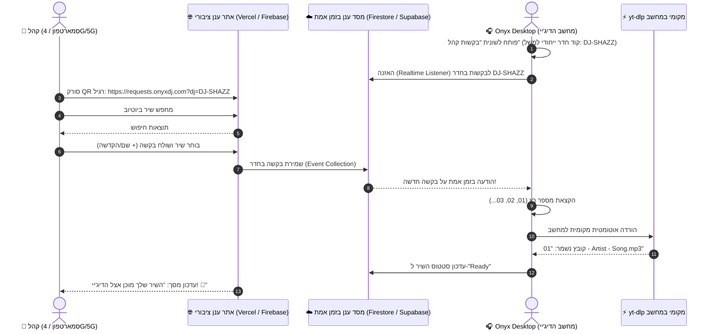

# תוכנית מעודכנת: פיצ'ר בקשות שירים מהקהל בענן (Onyx Cloud Requests)

> [!IMPORTANT]
> **שינוי ארכיטקטוני מרכזי (Zero Local Exposure):**  
> מחשב הדיג'יי **אינו משמש כשרת אינטרנט**. האתר אליו גולש הקהל מתארח בענן עצמאי (Cloud Hosting), והתקשורת מתבצעת דרך מסד נתונים מאובטח בענן בזמן אמת. המחשב שלך רק *מושך ומאזין* לבקשות מבפנים החוצה (Outbound Only), ולכן מוגן לחלוטין וללא תלות ב-IP מקומי או פורטים פתוחים.

---

## 1. ארכיטקטורה וזרימת מידע (Cloud-First Architecture)



---

## 2. פירוט רכיבי המערכת

### א. אתר הענן לקהל (Cloud Mobile Web App)
אתר ייעודי וקל משקל שמאוחסן בשירות ענן גלובלי (כגון **Vercel** או **Firebase Hosting**):
* **כתובת ציבורית קבועה:** כתובת אינטרנט מהירה ומאובטחת (HTTPS) שאינה תלויה במחשב שלך (למשל: `https://requests.onyxdj.com` או סאב-דומיין ייעודי).
* **זיהוי אירוע/דיג'יי (Room Slug):** הקישור ב-QR יכיל מזהה חדר של הדיג'יי (למשל: `?room=SHAZZ-LIVE`).
* **חיפוש יוטיוב עצמאי בענן:** מנוע חיפוש שעובד ישירות מהאתר (ללא עומס על המחשב שלך).
* **הגנת ספאם (Rate Limiting & Duplicate Guard):**
  * הגבלה לבקשה אחת למכשיר כל 3-5 דקות.
  * מניעת בקשות כפולות של אותו שיר שכבר ממתין בתור.
* **מסך מעקב לאורח:** האורח רואה את סטטוס השיר שלו בזמן אמת:  
  `בתור #03` ⬅️ `בהורדה אצל הדיג'יי...` ⬅️ `מוכן להשמעה! 🎉`

---

### ב. צינור הסנכרון בענן (Cloud Realtime Database)
שימוש ב-**Firebase Firestore** או **Supabase** (שירותים אמינים עם מסלול חינמי נדיב):
* **ללא צורך בשרת תחזוקה:** מסד נתונים NoSQL שדוחף עדכונים בזמן אמת (WebSocket/Push).
* **מבנה מסמך בקשה (Schema):**
  ```json
  {
    "id": "req_abc123",
    "room_id": "SHAZZ-LIVE",
    "title": "Levitating",
    "artist": "Dua Lipa",
    "youtube_url": "https://www.youtube.com/watch?v=TUVcZfQe-Kw",
    "thumbnail": "https://i.ytimg.com/vi/TUVcZfQe-Kw/hqdefault.jpg",
    "requester_name": "נועה",
    "dedication": "מזל טוב לכלה!",
    "created_at": 1776059400000,
    "status": "pending" // "pending" | "downloading" | "ready" | "played"
  }
  ```

---

### ג. מחשב הדיג'יי (תוכנת Onyx המקומית)
1. **האזנה ללא פתיחת פורטים (Outbound Listener):**
   * תוכנת Onyx במחשב מתחברת לענן כלקוח (Client). היא לא פותחת שום פורט, לא דורשת הגדרות ראוטר ולא חושפת את כתובת ה-IP שלך.
   * התוכנה יכולה לעבוד גם דרך נקודת גישה סלולרית (Hotspot) מהטלפון.
2. **ניהול מספר רץ כרונולוגי:**
   * המחשב שומר מונה רץ מקומי פר אירוע (`counter = 1, 2, 3...`).
   * עם הגעת בקשה חדשה מהענן:
     * מוקצה לה המספר הבא בתור (למשל `01`, `02`).
3. **הורדה אוטומטית מקומית:**
   * קריאה ישירה למנוע ההורדות הקיים של Onyx ([downloader.py](file:///Users/meir/Documents/Projects/OnyxYoutubeDownloader-Tauri/backend/downloader.py)).
   * שמירת הקובץ בתיקיית יעד: `~/Downloads/OnyxAudio/CrowdRequests/`.
   * **פורמט שם הקובץ:**  
     `01 - Dua Lipa - Levitating.mp3`  
     `02 - עומר אדם - רק שלך.mp3`
4. **פאנל ניהול בתוכנת הדיג'יי ([App.jsx](file:///Users/meir/Documents/Projects/OnyxYoutubeDownloader-Tauri/src/App.jsx)):**
   * לשונית ייעודית **"Crowd Requests 📱"**.
   * כפתור **"הצג קוד QR"** עם שם החדר והקישור להקרנה/סריקה.
   * טבלת בקשות חיה עם מספר רץ, שם המבקש וההקדשה.
   * כפתור השמעה מיידית (`Play`), כפתור פתיחת תיקייה (`Folder`), וכפתור סימון "נוגן" (`Played`).
   * צליל התראה (Chime) עדין כשיש בקשה חדשה.

---

## 3. יתרונות הארכיטקטורה המעודכנת

| קריטריון | גישה קודמת (המחשב כשרת) | **הגישה המעודכנת (ענן)** |
| :--- | :--- | :--- |
| **אבטחה** | מחשב הדיג'יי חשוף לגולשים | **המחשב מבודד לחלוטין ובטוח 100%** |
| **רשת הקהל** | חייב להיות באותו Wi-Fi | **עובד לכל אורח בכל רשת (סלולר/Wi-Fi)** |
| **עומס על המחשב** | חיפושי יוטיוב מעמיסים על המחשב | **החיפושים מתבצעים בענן; המחשב רק מוריד** |
| **יציבות** | תלוי בחיבורי רשת וראוטרים של האולם | **זמינות 99.9% דרך שרתי ענן מקצועיים** |

---

## 4. שלבי יישום בפועל (Implementation Roadmap)

1. **שלב 1: פרויקט אתר הענן (Crowd Web App)**
   * יצירת אפליקציית Web פשוטה ומעוצבת (React/HTML מותאם סלולר) עם שורת חיפוש יוטיוב, בחירת שיר, הזנת שם/הקדשה ושליחה לענן.
2. **שלב 2: הגדרת בסיס הנתונים בענן (Firebase/Supabase)**
   * יצירת טבלת/אוסף `requests` עם חוקי אבטחה (קריאה/כתיבה מאובטחת).
3. **שלב 3: מודול האזנה וסנכרון ב-Onyx ([src/App.jsx](file:///Users/meir/Documents/Projects/OnyxYoutubeDownloader-Tauri/src/App.jsx) / Python Backend)**
   * חיבור Onyx לקבלת אירועי זמן-אמת מהענן.
   * הפעלת מנגנון המספור הרץ (`01`, `02`...) והעברת ההורדה למנוע המקומי.
4. **שלב 4: ממשק הדיג'יי ב-Onyx**
   * הוספת לשונית "בקשות קהל", מחולל QR, ניהול תור והתראות.
5. **שלב 5: בדיקות קצה-אל-קצה**
   * סריקה מהטלפון הסלולרי ברשת 4G/5G, שליחת בקשה, ואימות שהקובץ יורד תוך שניות למחשב עם המספר הרץ המתאים.
