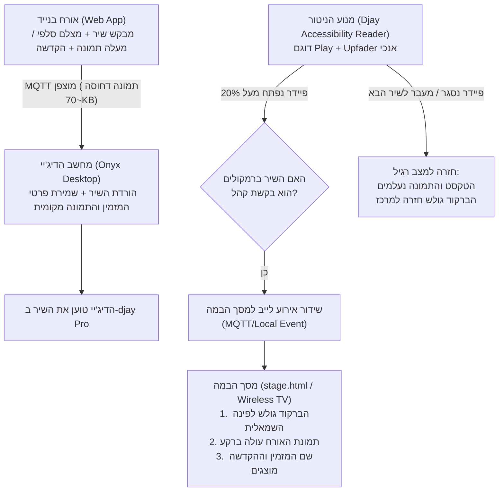

# תוכנית יישום: חוויית מסך במה אינטראקטיבית בזמן אמת (Crowd Stage Live Experience) 🎵📸

## 1. תקציר המערכת והיעד
בניית חוויית במה חיה ומסונכרנת: ברגע שהקומפניון מזהה ששיר שהוזמן על ידי אורח ברחבה עלה לרמקולים (Upfader פתוח), מסך הבמה והטלוויזיות (`stage.html`) יעברו באופן דינמי וחלק ממצב המתנה לתצוגת שיר חי:
1. **קוד ה-QR ינוע בצורה חלקה** ממרכז המסך אל הפינה השמאלית העליונה (יישאר ברור וסריק).
2. **התמונה שהאורח צילם או העלה** תוצג ברקע המסך בליווי אנימציית Ken-Burns עדינה.
3. **שם המזמין וההקדשה האישית** יופיעו במרכז המסך באפקט Fade-In יוקרתי.
4. **בסיום השיר / תחילת מיקס:** התמונה וההקדשה יתפוגגו ברכות, וה-QR יגלוש חזרה למרכז המסך.
5. **פרטיות מוחלטת:** התמונה עוברת ישירות למחשב הדיג'יי ונמחקת ללא שום שמירה בענן.

---

## 2. ארכיטקטורה ושלבי ביצוע

---

## 3. פירוט מודולי הפיתוח

### מודול א': שדרוג אפליקציית האורחים בנייד (`Dj-OnyxDownloader-Guest-Requests`)
1. **הוספת רכיב תמונה כפול:**
   * 📸 **"צלם סלפי / תמונה מהרחבה"** – הפעלת מצלמה ישירה (`capture="user"` / `capture="environment"`).
   * 🖼️ **"בחר תמונה מהגלריה"** – בחירת קובץ קיים.
2. **דחיסה חכמה בלקוח (Client-Side Compression):**
   * שימוש ב-HTML5 Canvas לכיווץ התמונה לגודל אופטימלי (עד 1280x720, איכות JPEG 0.8) לנפח קל של ~60-80KB.
   * מאפשר שידור מיידי בתוך שבריר שנייה גם בתנאי קליטה עמוסים באולם אירועים.
3. **אבטחה ופרטיות (Zero Cloud Footprint):**
   * התמונה משודרת כ-Base64 Payload ישירות בערוץ ה-MQTT לעמדת הדיג'יי.
   * **אפס אחסון בענן:** התמונה לא נשמרת באף שרת ציבורי, אלא מגיעה ישירות לזיכרון המקומי של תוכנת ה-Onyx.

---

### מודול ב': ניטור Upfaders וזיהוי שיר ברמקולים (`backend/djay_reader_lib.swift`)
1. **קריאת סליידר הווליום האנכי:**
   * הרחבת קורא ה-Accessibility ב-Swift כך שיקרא את ערך ה-`AXSlider` של הערוץ (`Volume, Deck 1` ו-`Volume, Deck 2`).
2. **לוגיקת שיר ברמקולים (Master Track):**
   * אם נגן 1 מנגן והווליום שלו מעל 20% וגבוה מנגן 2 $\rightarrow$ נגן 1 הוא השיר ברמקולים.
   * אם נגן 2 מנגן והווליום שלו פתוח $\rightarrow$ נגן 2 הוא השיר ברמקולים.
   * אם שיר מנגן אך הפיידר על 0 $\rightarrow$ השיר באוזניות בלבד ואינו משודר למסך הבמה.
3. **התאמה מול רשימת בקשות הקהל (Smart Song Matching):**
   * השוואה מהירה של שמות השיר והאמן מול רשימת הבקשות המקומית ב-Onyx.
   * ברגע שמזוהה התאמה לפיידר פתוח – מופץ אירוע `onyx/stage/{roomCode}/spotlight` עם פרטי המזמין, ההקדשה והתמונה.

---

### מודול ג': עיצוב ואנימציית מסך הבמה (`stage.html` & `QrStageWindow.jsx`)
1. **תנועת ה-QR הרציפה (CSS Transform & Motion):**
   * במצב רגיל: ה-QR ממורכז, גדול ובולט.
   * במצב שיר קהל פעיל: קוד ה-QR מבצע אנימציה חלקה (0.9s cubic-bezier) וגולש לפינה השמאלית העליונה, שם הוא מוקף במסגרת ניאון אלגנטית ("סרקו גם אתם 📱") ונשאר סריק לחלוטין.
2. **רקע התמונה (Guest Photo Backdrop):**
   * תמונת האורח עולה ב-Fade-in עדין עם שכבת הצללה כהה (Vignette) לקריאות מקסימלית של הטקסט.
   * אפקט תנועה איטי ויוקרתי (Ken-Burns Pan & Zoom).
3. **כרטיס ההקדשה המרכזי:**
   * תגית מוזהבת: `🎶 מתנגן עכשיו ברחבה`
   * שם השיר והמבצע באותיות ענק (48-56px).
   * שם האורח: `לבקשת: [שם המזמין] 💖`
   * ההקדשה: `"[טקסט ההקדשה]"` במירכאות מעוצבות.
4. **מעבר חזרה (Mix Out Transition):**
   * ברגע שהשיר מוחלף בתוכנת הדיג'יי – הטקסט והתמונה מתפוגגים ברכות וה-QR גולש בחזרה אל מרכז המסך.

---

## 4. שלבי עבודה וסדר ביצוע
1. [ ] **שלב 1:** הוספת צילום/העלאת תמונה בנייד האורח + כיווץ אוטומטי ב-Canvas.
2. [ ] **שלב 2:** הוספת קריאת פיידר הווליום ב-`djay_reader_lib.swift` ולוגיקת זיהוי שיר ברמקולים.
3. [ ] **שלב 3:** הוספת מנגנון שידור Spotlight ב-MQTT / SSE מעמדת הדיג'יי למסך הבמה.
4. [ ] **שלב 4:** הטמעת אנימציית גלישת ה-QR והקרנת התמונה/הקדשה ב-`stage.html` וב-`QrStageWindow.jsx`.
5. [ ] **שלב 5:** בדיקה מקצה לקצה (צילום תמונה בנייד $\rightarrow$ כניסה לעמדת הדיג'יי $\rightarrow$ פתיחת פיידר $\rightarrow$ הקרנה חיה במסך הבמה).
