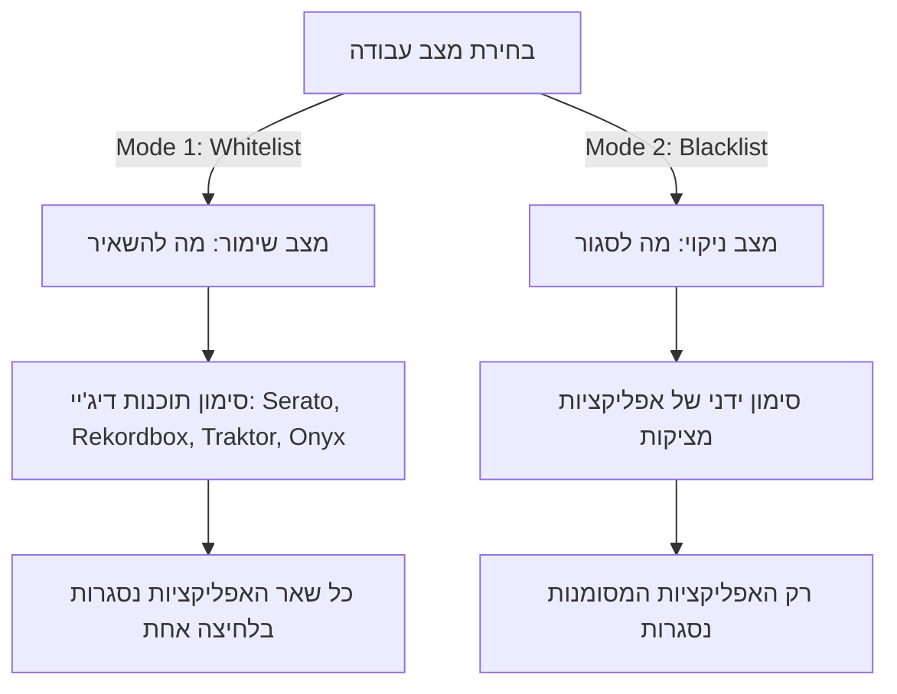
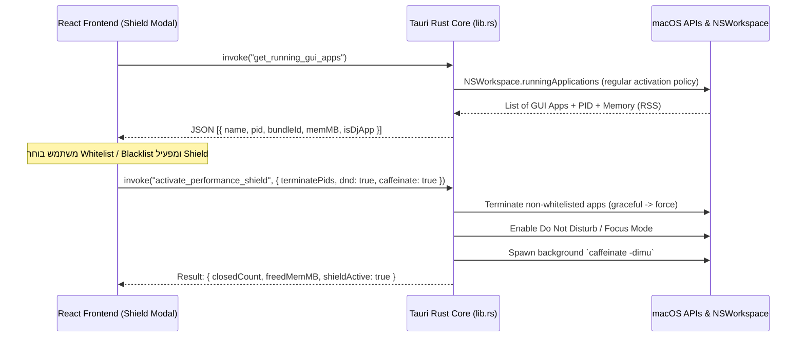

# אפיון ותוכנית עבודה: DJ Performance Shield (מגן הופעות וביצועים לדיג'יי)

מערכת ייעודית בתוך **Onyx** המכינה את מחשב ה-Mac לתקלוט חי (Live Gig), מונעת הפרעות חזותיות וקוליות (התראות וואטסאפ, שיחות נכנסות, הודעות מראה של ה-iPhone), ומפנה משאבי מעבד וזיכרון (RAM) לטובת תוכנות הדיג'יי.

---

## 1. הגדרת המוצר ומטרות (Product Overview)

### המטרה
בעת תקלוט באירוע, הדיג'יי חייב סביבת עבודה סטרילית לחלוטין:
1. **אפס תקלות זיכרון / CPU Spikes:** אפליקציות כבדות ברקע (כמו Chrome עם עשרות טאבים, Slack, Docker, Spotify) עלולות לגרום ל-Audio Buffer Dropouts (קפיצות בסאונד).
2. **אפס מבוכות חזותיות על מסך המחשב או המקרן:** התראות והודעות פרטיות (WhatsApp, הודעות SMS מהאייפון, תזכורות יומן, עדכוני מערכת) שמקפצות על המסך באמצע הסט.
3. **מניעת שינה / שומר מסך:** הבטחה שהמחשב לא יחשיך מסך או יינעל בזמן הופעה.

---

## 2. מפרט פונקציונלי (Functional Requirements)

### א. זיהוי וסינון אפליקציות GUI בלבד (App Discovery)
* המערכת תסרוק ותציג **אך ורק אפליקציות משתמש רגילות עם ממשק גרפי (Regular GUI Apps)**.
* **החרגה אוטומטית של תהליכי מערכת:** תהליכי ליבה (`launchd`, `kernel_task`, `WindowServer`, `mds`, דמונים סמויים) **לא יוצגו כלל** כדי למנוע סכנת קריסה של מערכת ההפעלה.
* **הגנה מובנית על אפליקציות ליבה (Non-Killable):**
  * **Onyx** (התוכנה עצמה).
  * **Finder** (סייר הקבצים של Apple).
* לכל אפליקציה יוצגו:
  * אייקון האפליקציה ושם מלא (למשל: Google Chrome, WhatsApp, Spotify).
  * צריכת זיכרון נוכחית ב-MB / GB.
  * PID (מזהה תהליך) ו-Bundle Identifier.

---

### ב. שני מצבי עבודה (Operational Modes - Toggle)

1. **מצב Whitelist (שימור – "מה להשאיר"):**
   * **ברירת המחדל המומלצת לדיג'יי.**
   * המשתמש מגדיר את סביבת העבודה שלו (למשל: *Serato DJ Pro*, *Rekordbox*, *Traktor Pro*, *djay Pro*, *Mixed In Key*, *Onyx*).
   * בלחיצה על **"הפעל מגן הופעה"**, המערכת סוגרת בבת אחת את **כל שאר האפליקציות** שרצות במחשב.
2. **מצב Blacklist (סגירה ממוקדת – "מה לסגור"):**
   * המערכת מציגה את רשימת כל האפליקציות הפעילות.
   * המשתמש מסמן ב-V אילו אפליקציות ספציפיות ברצונו לסגור כעת (למשל סגירת WhatsApp ו-Telegram בלבד).
   * חישוב בזמן אמת של סך הזיכרון שיתפנה (למשל: *"פינוי משוער: 2.8 GB RAM"*).

---

### ג. חבילת נטרול הפרעות (Distraction Shield & System Tweaks)

מתג ייעודי **"נטרול הפרעות והתראות 🔕"** שמפעיל במקביל:
1. **מצב ריכוז / Do Not Disturb (DND):**
   * חוסם מיידית באנרים של הודעות, צלילי התראות והודעות קופצות.
   * **חוסם התראות המועברות מהאייפון (iPhone Mirroring & Notification Forwarding ב-macOS Sequoia/Sonoma).**
2. **מניעת שינה (Caffeinate System):**
   * הפעלת שירות מניעת שינה של macOS, המבטיח שהמסך, הכוננים והמעבד לא ייכנסו ל-Sleep או Screen Saver.
3. **שחזור אוטומטי בסיום האירוע (Deactivate Shield):**
   * כפתור יציאה ממצב הופעה שמחזיר את מצב ההתראות לקדמותו ומבטל את ה-Caffeinate.

---

## 3. ארכיטקטורה טכנולוגית (Technical Architecture)

### א. צד ה-Backend (Rust - `src-tauri/src/lib.rs`)
1. **`get_running_gui_apps`:**
   * שאילתא ל-`NSWorkspace.sharedWorkspace.runningApplications` באמצעות AppleScript מהיר או Cocoa bindings.
   * סינון: `activationPolicy == .regular` (אפליקציות עם חלונות/אייקון ב-Dock).
   * שליפת נתוני זיכרון RAM (Resident Memory via `proc_pidinfo` / `ps`).
   * זיהוי אוטומטי של תוכנות DJ ידועות לפי Bundle ID / שם (Serato, Pioneer Rekordbox, Native Instruments Traktor, Algoriddim djay, VirtualDJ, Ableton Live).
2. **`terminate_apps(pids: Vec<u32>, force: bool)`:**
   * ניסיון סגירה מסודר (`SIGTERM` / `NSRunningApplication.terminate`) כדי לשמור הגדרות.
   * אם האפליקציה לא נסגרת תוך 1.5 שניות – סגירה כפויה (`SIGKILL`).
3. **`set_focus_mode(enabled: bool)`:**
   * הפעלת מצב Focus / Do Not Disturb ב-macOS באמצעות AppleScript ופקודות מערכת של Control Center.
4. **`set_caffeinate(enabled: bool)`:**
   * ניהול תהליך רקע של הפקודה המובנית ב-Mac: `caffeinate -dimsu`.

### ב. צד ה-Frontend (React - `src/DjPerformanceShieldModal.jsx`)
* **עיצוב בסגנון Dashboard מתקדם לדיג'יי:**
  * מחוון מצב גדול: **"SHIELD ACTIVE 🛡️"** או **"STANDBY ⚪"**.
  * טבלת אפליקציות עם אייקונים, שמות, ותגיות צריכת RAM.
  * כפתורי בחירה מהירה: *"בחר הכל"*, *"סמן רק דפדפנים ורשתות חברתיות"*, *"נקה בחירה"*.
  * שורת סטטיסטיקה דינמית: סך הזיכרון שישוחרר (למשל: `🔥 ישוחררו 4,120 MB RAM ויושתקו כל ההתראות`).

---

## 4. תוכנית עבודה הנדסית בשלבים (Implementation Plan)

| שלב | משימה | קבצים מעורבים | תכולה |
| :--- | :--- | :--- | :--- |
| **שלב 1** | **פקודות Rust בסיסיות (Backend)** | `src-tauri/src/lib.rs`, `Cargo.toml` | מימוש פקודות Tauri לשליפת אפליקציות GUI בלבד, סגירת תהליכים, מצב ריכוז ו-caffeinate. |
| **שלב 2** | **ממשק המשתמש (UI Component)** | `src/DjPerformanceShieldModal.jsx` | יצירת מודאל מעוצב עם מתג Whitelist/Blacklist, רשימת אפליקציות אינטראקטיבית וחישוב זיכרון. |
| **שלב 3** | **שמירת פרופילים והגדרות** | `src/DjPerformanceShieldModal.jsx` | שמירה ב-`localStorage` של רשימת ה-Whitelist האישית של הדיג'יי, כך שבאירוע הבא מספיקה לחיצת כפתור אחת. |
| **שלב 4** | **אינטגרציה בסרגל הכלים הראשי** | `src/App.jsx` | הוספת כפתור ייעודי בסרגל העליון: `מגן הופעה 🛡️` עם אינדיקטור פעיל/כבוי חי. |
| **שלב 5** | **בדיקות בטיחות, Build & Packaging** | Mac Environment | בדיקת חסינות (לוודא ש-Onyx לא יכולה לסגור את עצמה או קבצי ליבה), קומפילציה ויצירת DMG מעודכן. |

---

## 5. החלטות ושאלות מנחות לתיאום לפני ביצוע

1. **מיקום הכפתור הראשי:** האם להציב את הכפתור **"מגן הופעה 🛡️"** בראש המסך הראשי של התוכנה לצד הגדרות המערכת, או בתוך תפריט ייעודי?
2. **סגירה אוטומטית בעת הפעלת התקלוט:** האם תרצה אפשרות בהגדרות שמפעילה את ה-Shield אוטומטית ברגע שמתחילים לנגן שיר בנגן ה-OnyxPlayer?
3. **התראת אישור סגירה:** האם לדרוש אישור משתמש (Confirm Popup) לפני סגירת האפליקציות, או לבצע מיידית בלחיצה על כפתור הפעולה הראשי?
