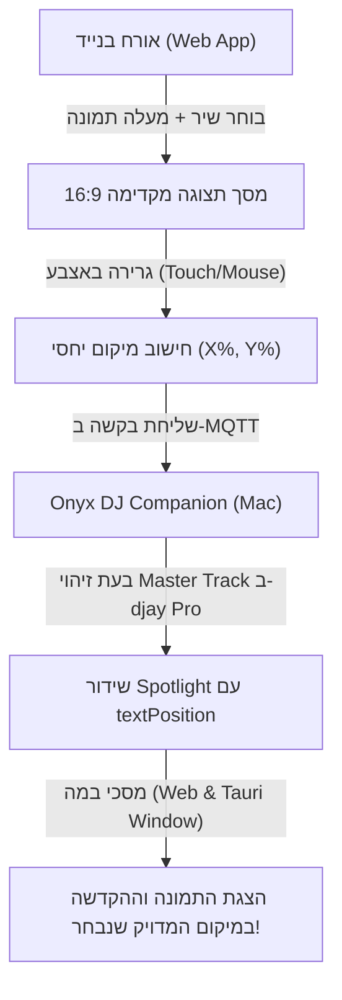

# תוכנית עבודה: תצוגה מקדימה אינטראקטיבית וגרירת טקסט ההקדשה במכשיר האורח (Interactive Stage Preview & Draggable Text)

## 🎯 מטרת הפיצ'ר
לאפשר לאורח המבקש שיר ומצרף תמונה (סלפי או מהגלריה) לראות **תצוגה מקדימה חיה של מסך הבמה (ביחס 16:9)**, ובו הוא יכול **לגרור באצבע (Touch & Drag)** את תיבת הטקסט (שם המזמין, ההקדשה ושם השיר) לכל מיקום רצוי — כך שהטקסט לא יסתיר את הפנים שלו או את הפרטים החשובים בתמונה!
המיקום הנבחר יישמר ויועבר ישירות למסך הבמה הראשי, שיציג את ההקדשה בדיוק בנקודה שהאורח בחר.

---

## 🏗️ ארכיטקטורה וזרימת נתונים (Data Flow)



---

## 📋 שלבי המימוש

### שלב 1: מסך תצוגה מקדימה אינטראקטיבי במובייל (`Dj-OnyxDownloader-Guest-Requests/index.html`) ✅ הושלם בהצלחה
1. **קונטיינר 16:9 יוקרתי (Stage Simulator):**
   - ביחס מסך 16:9 מדויק המשקף מסך אולם/לד/מקרן.
   - מציג את תמונת האורח שנבחרה/צולמה ברקע עם שכבת ה-Vignette הכהה.
   - מציג את קוד ה-QR הממוזער בפינה השמאלית העליונה (כמו במסך האמיתי), כדי שהאורח יראה מראש מה מכוסה ומה פנוי.
2. **כרטיס טקסט נגרר ומעודן (Compact Draggable Dedication Card):**
   - **היררכיה טיפוגרפית מותאמת:** שם השיר והמבצע יוצגו ב**פונט קטן ומעודן יותר** (כותרת משנה אלגנטית / תגית יוקרתית), כך שמרכז הבמה יישמר לתמונה, לשם המזמין ולהקדשה המרגשת!
   - **גודל כרטיס קומפקטי:** מקל על האורח למקם את הכרטיס בכל פינה מבלי לתפוס שטח נרחב מהתמונה.
   - **אירועי מגע ועכבר:** תמיכה מלאה ב-`touchstart/touchmove/touchend` למובייל ו-`mousedown/mousemove/mouseup` לדסקטופ.
   - **גבולות בטוחים (Safe Boundaries):** הגבלה חכמה כך שהכרטיס לא יחרוג מגבולות המסך ולא יסתיר את ה-QR שבפינה.
   - **כפתורי יישור מהירים (Quick Presets):** הוספת כפתורי קיצור קטנים: "למטה", "מרכז", "למעלה" למקרה שהמשתמש מעדיף לחיצה מהירה במקום גרירה.
3. **שמירת קואורדינטות יחסיות:**
   - חישוב באחוזים: `posX` (מ-22% עד 78%) ו-`posY` (מ-20% עד 80%).
   - צירוף `textPosition: { x: posX, y: posY }` ל-Payload הנשלח ב-MQTT.

---

### שלב 2: קליטה והפצה ב-DJ Companion (`src/GuestRequestsModal.jsx`) ✅ הושלם בהצלחה
1. **שימור המיקום:** קליטת `textPosition` במודול `processIncomingRequest` ושמירתו כחלק מאובייקט הבקשה.
2. **שידור Spotlight:** בעת נגינת השיר ב-djay Pro, העברת `textPosition` ב-Payload של ה-Spotlight הנשלח למסכים.

---

### שלב 3: מיקום דינמי וטיפוגרפיה מעודנת במסכי הבמה (`stage.html` ו-`QrStageWindow.jsx`) ✅ הושלם בהצלחה
1. **עידון פונט שם השיר והאמן:**
   - הקטנת הפונט של שם השיר והמבצע לכ-22px-30px כבאנר יוקרתי, כך שההקדשה והתמונה מקבלות את מלוא תשומת הלב.
2. **מיקום מדויק של כרטיס ה-Spotlight:**
   - שימוש במיקום הנבחר:
     ```css
     left: ${data.textPosition.x}%;
     top: ${data.textPosition.y}%;
     transform: translate(-50%, -50%);
     ```
   - אנימציית מעבר חלקה של מיקום הכרטיס.
3. **ברירת מחדל (Fallback):** אם לא הוגדר מיקום, הכרטיס מוצג ב-`{ x: 50, y: 75 }` (חלק תחתון מרווח).

---

### שלב 4: בדיקות, פריסה ל-Vercel ובניית DMG ✅ הושלם בהצלחה
1. **פריסה ל-Vercel:** הועלתה בהצלחה ל-Production בכתובת `https://dj-onyxdownloader-guest-requests.vercel.app`.
2. **בניית DMG סופי:** הופקה גרסת Release מקומפלת ומאומתת הכוללת את `djay_reader.dylib`.
3. **מיקום הקבצים:**
   - קובץ DMG בתיקיית הפרויקט: `./OnyxYoutubeDownloader.dmg`
   - שולחן העבודה: `~/Desktop/OnyxYoutubeDownloader.dmg`
   - תיקיית ההורדות: `~/Downloads/OnyxYoutubeDownloader.dmg`
   - מותקן מוכן להפעלה: `/Applications/OnyxYoutubeDownloader.app`
4. **Git:** הקוד נשמר ונדחף לענף הראשי ב-GitHub (`main`).

---

## 💡 יתרונות לחוויית המשתמש (UX)
- **שליטה מלאה לאורח:** מונע מצב שבו טקסט ההקדשה מכסה פנים של חתן/כלה או חברים בתמונה.
- **WYSWYG (מה שרואים זה מה שמקבלים):** האורח רואה במדויק איך תיראה הבקשה שלו על גבי מסכי הענק באולם עוד לפני שהוא לוחץ "שלח".
- **פשוט, מהיר ואינטואיטיבי:** גרירה פשוטה באצבע בלי הגדרות מסובכות.
